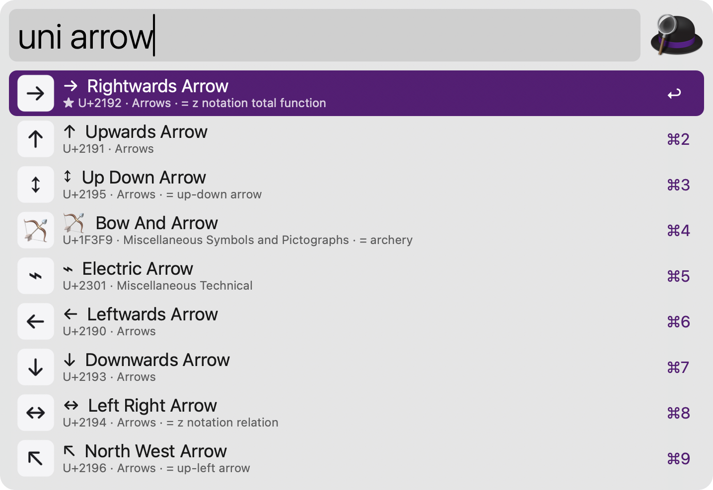
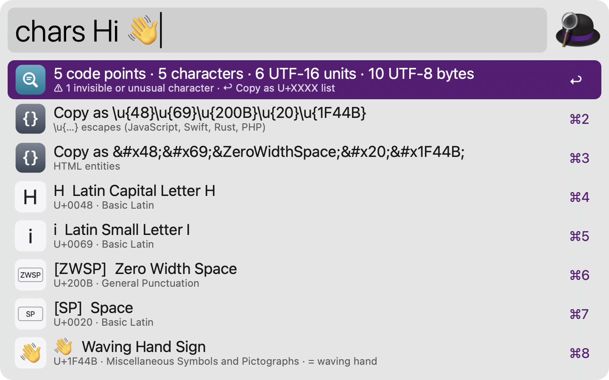
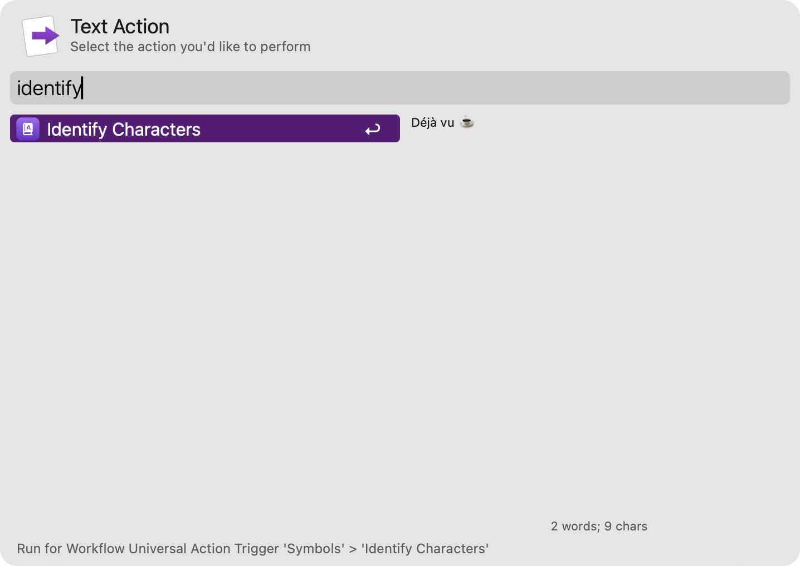
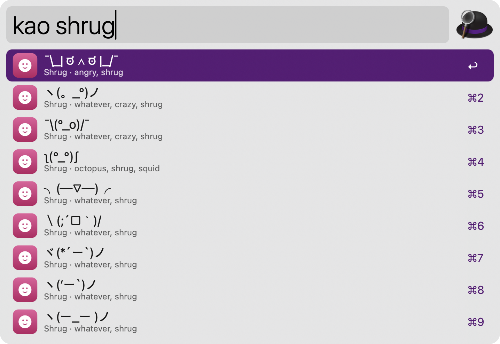
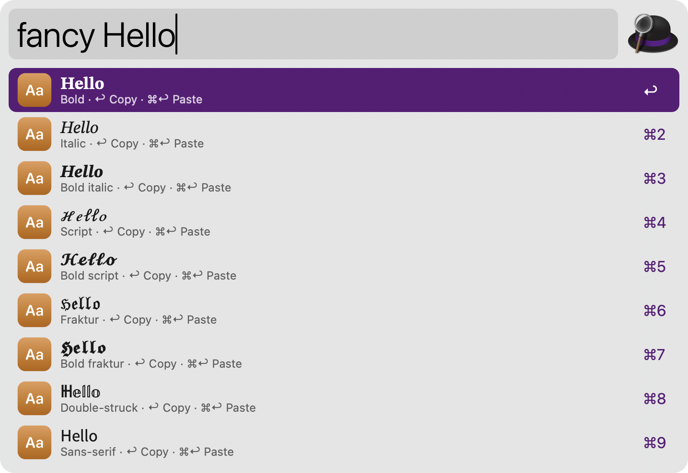
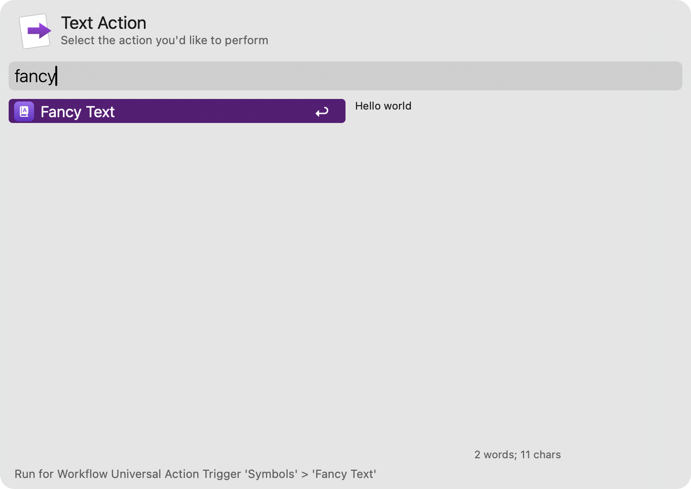
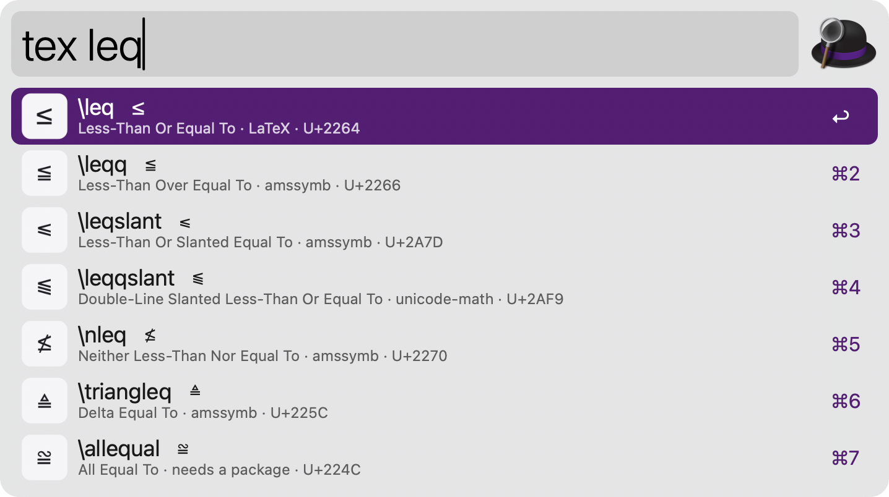
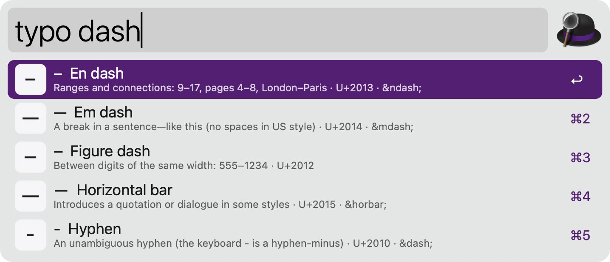
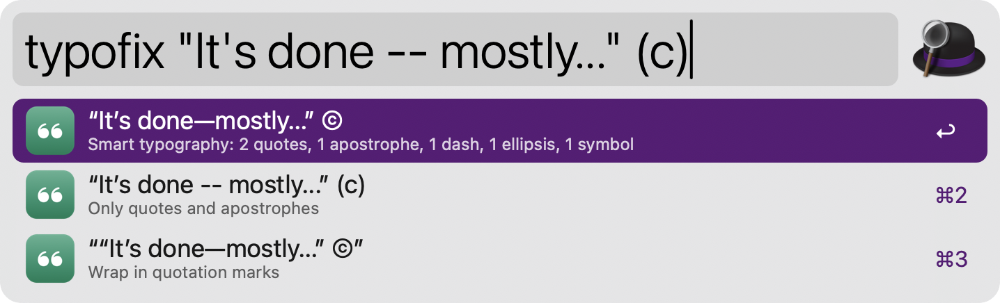
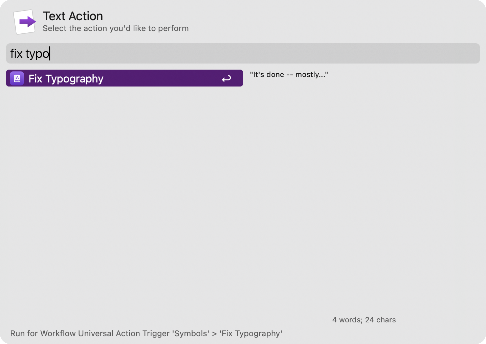

#  Symbols

Find any Unicode character, identify the ones you paste, and copy kaomoji, fancy text, LaTeX commands and typographic characters. Everything works offline, with no dependencies.

## Usage

Search all 172,873 characters of Unicode 18.0 and every emoji via the `uni` keyword. Type a name or an alias (`arrow`, `nbsp`, `pilcrow`), a code point in any notation (`U+2192`, `2192`, `\u{1F600}`, `&#x2192;`) or an HTML entity (`&rarr;`). Leave it empty to see your favourites and recently used characters.



* <kbd>↩</kbd> Copy the character.
* <kbd>⌘</kbd><kbd>↩</kbd> Paste it into the frontmost app.
* <kbd>⌥</kbd><kbd>↩</kbd> Copy it as an HTML entity, a `\u{…}` escape or `U+XXXX`, as chosen in the Workflow’s Configuration.
* <kbd>⌘</kbd><kbd>⌥</kbd><kbd>↩</kbd> Show every format: HTML entities, escapes for JavaScript, Python and CSS, UTF-8 bytes, LaTeX.
* <kbd>⌃</kbd><kbd>↩</kbd> Add to or remove from favourites.
* <kbd>⌘</kbd><kbd>Y</kbd> Quick Look the character large, with its details.
* <kbd>⌘</kbd><kbd>L</kbd> Show the character in Large Type.

### What Is This Character?

Identify each character of the clipboard via the `chars` keyword, or type or paste text after it. You see every code point with its name, how many characters, UTF-16 units and UTF-8 bytes the text has, and a warning about invisible characters like zero width spaces. A single character shows all of its formats.



Alternatively, identify selected text via the Universal Action. Pasting characters after `uni` works too.



### Kaomoji

Search 1,800 kaomoji and emoticons via the `kao` keyword, by feeling or theme, like `shrug`, `table flip` or `cat`. Leave it empty to browse the categories.



* <kbd>↩</kbd> Copy the kaomoji.
* <kbd>⌘</kbd><kbd>↩</kbd> Paste it into the frontmost app.
* <kbd>⌃</kbd><kbd>↩</kbd> Add to or remove from favourites.

### Fancy Text

Turn text into 𝐛𝐨𝐥𝐝, 𝑖𝑡𝑎𝑙𝑖𝑐, 𝓈𝒸𝓇𝒾𝓅𝓉, 𝔣𝔯𝔞𝔨𝔱𝔲𝔯, 𝕕𝕠𝕦𝕓𝕝𝕖-𝕤𝕥𝕣𝕦𝕔𝕜, ｆｕｌｌｗｉｄｔｈ, ⓒⓘⓡⓒⓛⓔⓓ, ꜱᴍᴀʟʟ ᴄᴀᴘꜱ, s̶t̶r̶i̶k̶e̶t̶h̶r̶o̶u̶g̶h̶, uʍop ǝpᴉsdn and more via the `fancy` keyword. Leave it empty to style the clipboard. Styled text is turned back into plain text too.



Alternatively, style selected text via the Universal Action. Screen readers may not read styled text aloud, so keep it for decoration.



### LaTeX

Search 3,000 LaTeX commands via the `tex` keyword, by command (`\leq`, `alpha`), by name (`subset`) or by pasting the symbol (`∈`). Each row shows the package the command needs: LaTeX, amssymb, mathrsfs or unicode-math.



* <kbd>↩</kbd> Copy the command.
* <kbd>⌘</kbd><kbd>↩</kbd> Paste the command into the frontmost app.
* <kbd>⌥</kbd><kbd>↩</kbd> Copy the Unicode character instead.
* <kbd>⌃</kbd><kbd>↩</kbd> Add to or remove from favourites.

### Typography

Find the right typographic character, with a note on when to use it, via the `typo` keyword: quotation marks for many languages, dashes, spaces, marks and symbols. Type `dash`, `quote` or `space` to narrow the list.



Fix the typography of the clipboard, or of text typed after it, via the `typofix` keyword: curly quotes and apostrophes, en and em dashes, ellipses, ©, ™, ×, fractions and primes. Code between backticks, URLs and HTML tags stay untouched. The quotation marks and dash style are set in the Workflow’s Configuration.



Alternatively, fix selected text via the Universal Action, then press <kbd>⌘</kbd><kbd>↩</kbd> to paste the fixed text over it.



Every keyword can be changed in the Workflow’s Configuration.

## Development

```bash
python3 tools/build_data.py                          # regenerate src/data/ from the Unicode and other sources
swift tools/make_icons.swift tools/icons.json src   # regenerate icons
python3 tools/build.py --package                     # write src/info.plist and dist/*.alfredworkflow
python3 tests/test_symbols.py                        # run the tests
```

The data comes from the [Unicode Character Database](https://www.unicode.org/ucd/) 18.0.0 and its emoji data (Unicode License v3), [unicode.xml](https://www.w3.org/2003/entities/2007xml/) by David Carlisle (W3C Software License) for LaTeX, and [asciilib](https://github.com/iansinnott/asciilib) by Ian Sinnott (MIT) for kaomoji. See `src/data/NOTICE.txt`.

## AI disclosure

This workflow was developed with the help of Claude (Anthropic), an AI assistant. The code is reviewed and tested by the author.
